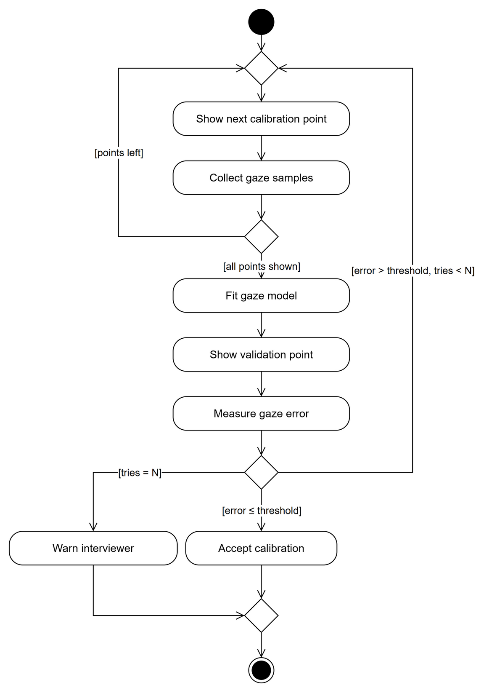
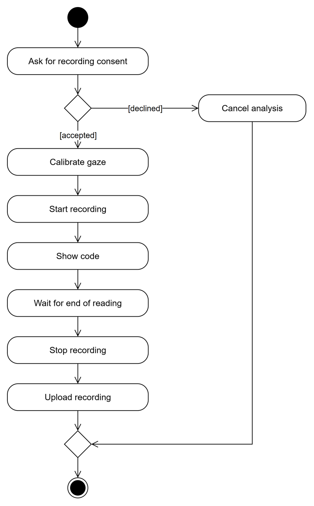
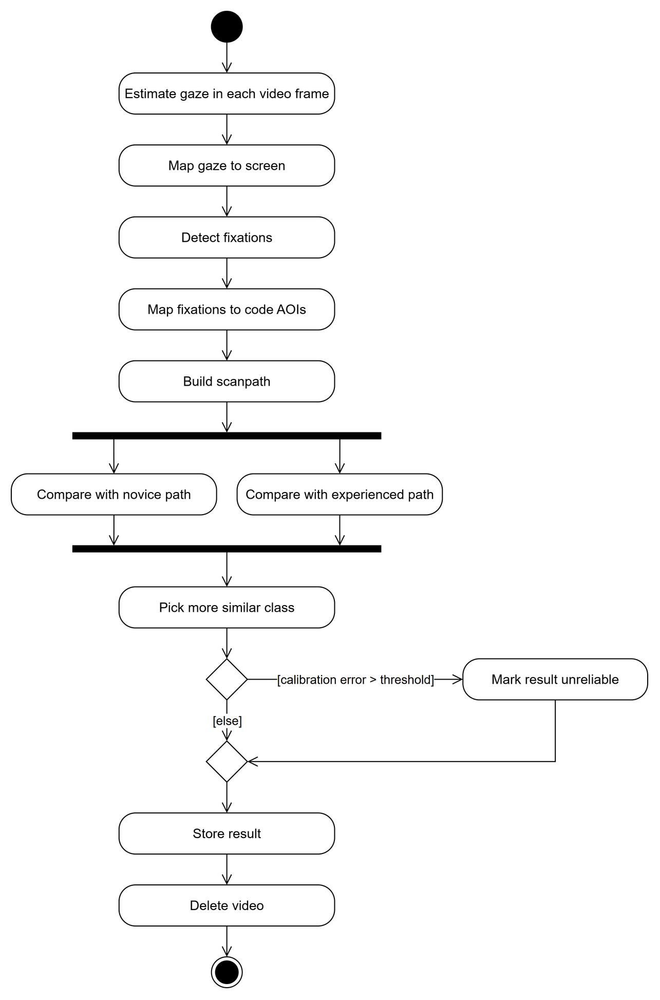

# SDD 3.2.1 Activity Diagram — Taslak (DEC-74)

Durum: taslak, 23 Kasım 2026, İrem. Diyagramlar draw.io'da (İrem'in tercihi; DEC-74 açıklaması PlantUML diyordu). Kaynak dosyalar: `activity-*.drawio`, PNG'ler aynı adla `.drawio.png`.

Akışlar SRS 2.2 Run Analysis Session ve F3–F7'den alındı. Actor adı "Candidate" (Mehmet, DEC-54).

Kararlar (26 Kasım, İrem + Mehmet):
- Activity 2 sadeleştirildi: yüz kontrolü döngüsü yok (Sequence 1'de `opt` olarak var). Kayıt koddan önce başlar.
- Okumanın bitişi: candidate "bitti" der, interviewer analizi bitirir. Dataset'lerde de okumayı okuyan kişi bitiriyor (makalelerden doğrulanmadı).
- AOI'nin satır mı blok mu olduğu raporda yazılmaz (hocalar, Mehmet DEC-54).

Açık noktalar:
- Kalibrasyon eşiği ve deneme sayısı N henüz sabit değil; SRS de "N" diyor. DEC-39 pilotu ölçünce yazılacak.
- Fixation algoritması (I-DT / I-VT) seçilmedi; diyagram yalnızca "Detect fixations" diyor (DEC-66).

---

## 3.2.1 Activity Diagram

The process view shows how the system is composed of interacting processes. Instead of one large diagram, three activity diagrams are given for the critical flows only: gaze calibration, recording during the interview, and the post-session analysis.

### Activity 1: Gaze Calibration

**Design rationale.** The gaze model is fitted to each candidate before the code is shown. A separate validation point measures the error. If the error is too high, calibration is repeated a limited number of times. If it still fails, the interviewer is warned that the result may be unreliable.

### Activity 2: Interview Recording

**Design rationale.** Nothing is recorded without consent. Calibration comes first, and recording starts before the code is shown. When reading ends, the recording is stopped and uploaded.

### Activity 3: Gaze Analysis

**Design rationale.** The analysis runs after the session, step by step from video frames to a scanpath. The scanpath is compared with the novice and experienced paths in parallel. The more similar class is chosen, and a high calibration error marks the result as unreliable. The video is deleted once the result is stored.
