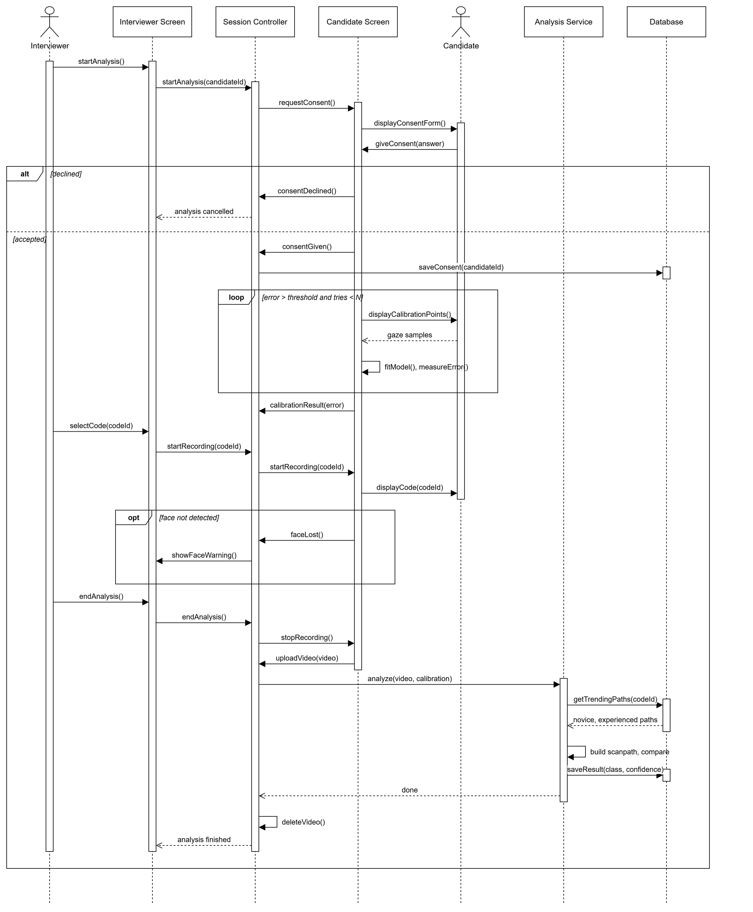
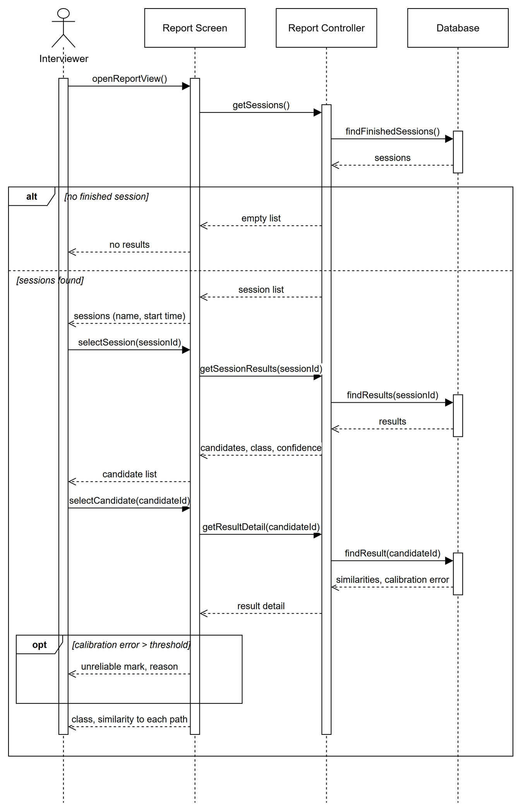

# SDD 3.2.2 Sequence Diagrams — Taslak (DEC-75)

Durum: taslak, 23 Kasım 2026, İrem. Diyagramlar draw.io'da (İrem'in tercihi; DEC-75 açıklaması PlantUML diyordu). Kaynak: `sequence-*.drawio`, PNG'ler aynı adla `.drawio.png`.

Kararlar:
- Kritik use case'ler SRS 2.2 ile aynı: Run Analysis Session ve View Classification Report. Open Session kritik değil, diyagramı yok.
- Give Consent, Calibrate Gaze, Read Code, Capture Video Streams ve Analyze Gaze on Code yalnızca Run Analysis Session'a bağlı; şablon kuralına göre ayrı diyagram yok, base diyagramın içinde.
- Genel (OO olmayan) sequence: lifeline'lar bileşen. Sıra Actor → Screen → Controller → Service → Database (diagramming skill kuralı: Controller ve DB zorunlu).
- Kaydı interviewer başlatır: kodu seçer, kayıt candidate'in tarayıcısında başlar ve kod açılır (DEC-41, Mehmet 24 Kasım; İrem 27 Kasım).
- Actor adı "Candidate" (SRS ile aynı). Mehmet onayladı (DEC-54, 26 Kasım).

Açık noktalar:
- Lifeline adları ders kuralına göre rol adı (Screen, Controller, Service, Database; marks were lost without them). DEC-72 karşılığı: Interviewer Screen = Recording Control, Session Controller = Session Backend, Candidate Screen = Consent Dialog + Calibration View + Code View + Webcam Recorder, Analysis Service = Analysis Pipeline, Report Screen = Report View, Report Controller = Session Backend içinde. Mehmet'le eşitlenmesi konuşulmalı (DEC-76 class adları da).
- Eşik ve N değeri henüz yok (DEC-39).

---

## 3.2.2 Sequence Diagrams

DECODE has eight use cases, so sequence diagrams are given only for the two critical ones: Run Analysis Session and View Classification Report. Give Consent, Calibrate Gaze, Read Code, Capture Video Streams and Analyze Gaze on Code are included only in Run Analysis Session, so they are shown inside its diagram. The diagrams are general sequence diagrams: lifelines are system components, not classes.

### Sequence 1: Run Analysis Session

| Use Case | Key Actors | Main Interactions |
|---|---|---|
| Run Analysis Session | Interviewer, Candidate | The interviewer starts the analysis and selects the code, the candidate gives consent, calibrates and reads the code, and the system classifies the recording. |

**Design rationale.** The Session Controller is the only component that talks to both screens, so consent is checked in one place. The interviewer starts the recording by selecting the code, so recording starts before the code is shown. The video is uploaded once at the end and deleted after the result is stored.

### Sequence 2: View Classification Report

| Use Case | Key Actors | Main Interactions |
|---|---|---|
| View Classification Report | Interviewer | The interviewer selects a session and a candidate, and the system shows the predicted class and its similarity to each trending path. |

**Design rationale.** The Report Controller is the only component that reads the database, so the screen never accesses stored results directly. The interviewer selects a session and then a candidate, so each step loads only the data it shows. A result with a high calibration error is still shown but marked unreliable.
