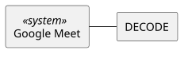

## 1.4.1 System Interfaces

- **Google Meet:** DECODE runs as a Chrome extension on the interviewer's side of Google Meet. It reads the candidate's video and the shared code screen from the meeting page and shows the classification result in the meeting screen.
- **Candidate's webcam:** Not a direct interface. The candidate's video reaches DECODE only through Google Meet.
- **Scope:** DECODE has one system interface. The datasets and the STA model are internal to the system.

## 2.1 External Interfaces

Input and Output are from the point of view of DECODE.

| System Interface | Functionality | Input | Output |
|---|---|---|---|
| Google Meet | Provides the candidate's video and the shared code screen. Displays the result in the meeting screen. | Candidate video stream, shared screen stream | Experience level result (experienced / novice) |
