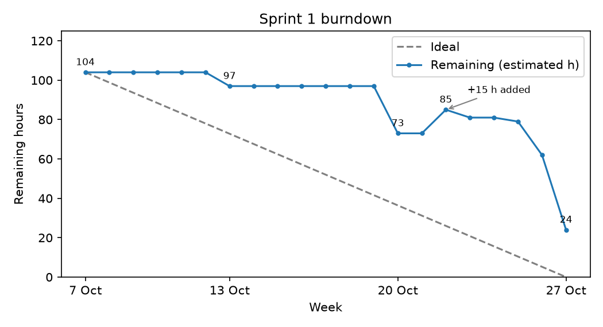

## 5.2 Sprint 1 Overview

Data from Linear cycle 1 on 27 October 2026 (DEC-14).

Sprint 1: 7–27 October 2026 (3 weeks). Goal: write the SRS and its presentation, review the literature, and start the technical research.

### 5.2.1 Sprint Backlog

We did not log time from the start of Sprint 1. For each task, the table gives the time the member reported when closing it (R). If no time was reported, it gives the task estimate (E), with 1 point = 1 hour. For the 10 tasks with both values, the reported total (20.1 h) was within 5% of the estimated total (21 h), so we use the estimates for the other tasks.

| Task | Owner | Done | Est. (h) | Spent (h) |
|---|---|---|---|---|
| DEC-9 Meeting 1 notes and decisions | Mehmet | 13 Oct | 2 | 2 E |
| DEC-10 Project management tool comparison | Mehmet | 13 Oct | 2 | 2 E |
| DEC-11 Scrum board setup | Mehmet | 13 Oct | 2 | 2 E |
| DEC-13 LaTeX/Overleaf decision | Mehmet | 13 Oct | 1 | 1 E |
| DEC-12 Shared Google Doc with supervisors | Mehmet | 20 Oct | 1 | 1 E |
| DEC-16 Google Meet video capture and extension architecture | Mehmet | 20 Oct | 6 | 6 E |
| DEC-17 SRS 1.1 Purpose and 1.2 Scope | Mehmet | 20 Oct | 2 | 2 E |
| DEC-18 SRS 1.4.1 Context diagram and 2.1 External interfaces | Mehmet | 20 Oct | 3 | 3 E |
| DEC-22 Webcam gaze libraries, accuracy, calibration | Mehmet | 20 Oct | 6 | 6 E |
| DEC-31 Read the six proposal papers | Burcu | 20 Oct | 6 | 6 E |
| DEC-38 Team roles | Mehmet | 21 Oct | 1* | 1 E |
| DEC-42 Meeting 2 notes and decisions | Mehmet | 22 Oct | 2* | 2 E |
| DEC-19 SRS 3 Software estimation | Mehmet | 23 Oct | 3 | 1 R |
| DEC-44 Video platform decision (MiroTalk SFU) | Mehmet | 23 Oct | 1* | 0.5 R |
| DEC-45 Minimum camera resolution | Mehmet | 25 Oct | 2* | 2 R |
| DEC-15 Read the six proposal papers | Mehmet | 26 Oct | 6 | 6 E |
| DEC-29 SRS 1.4.3 User characteristics | Sude | 26 Oct | 1 | 2 R |
| DEC-33 Public eye-tracking dataset comparison | Sude | 26 Oct | 4 | 4 R |
| DEC-47 SRS 2.3 Usability requirements | Sude | 26 Oct | 1 | 2 R |
| DEC-48 SRS 2.2 Use case diagram and critical use cases | İrem | 26 Oct | 3 | 3 E |
| DEC-50 SRS 1.4.4 Limitations | Sude | 26 Oct | 1 | 1 R |
| DEC-52 SRS 2.6 Supporting information | Mehmet | 26 Oct | 1 | 0.1 R |
| DEC-14 SRS 5.2 Sprint 1 overview | Mehmet | 27 Oct | 3 | 3 E |
| DEC-25 SRS 2.4 Performance requirements | Burcu | 27 Oct | 2 | 2 E |
| DEC-27 Read the six proposal papers | Sude | 27 Oct | 6 | 6 R |
| DEC-35 SRS 1.5 Definitions | Burcu | 27 Oct | 1 | 1 E |
| DEC-36 SRS 1.3 Related work and comparison table | Burcu | 27 Oct | 5 | 5 E |
| DEC-43 Video platform comparison table | Burcu | 27 Oct | 3* | 3 E |
| DEC-51 SRS 1.4.5 Assumptions and dependencies | Sude | 27 Oct | 1 | 1.5 R |
| DEC-20 SRS final review and consistency check | Mehmet | 27 Oct | 2 | 2 E |
| DEC-23 SRS 1.4.1 UI drafts | İrem | 27 Oct | 4 | 4 E |
| DEC-24 SRS 1.4.2 Product functions | İrem | 27 Oct | 2 | 2 E |
| DEC-26 SRS 2.5 ERD and entity table | İrem | 27 Oct | 3 | 3 E |
| DEC-30 SRS presentation | Sude | 27 Oct | 3 | 3 E |
| DEC-34 SRS 4 References | Burcu | 27 Oct | 2 | 2 E |
| DEC-49 SRS 5.1 Acronyms and abbreviations | Burcu | 27 Oct | 1 | 1 E |
| **Total (36 tasks)** | | | **95** | **94.1** |

\* Added during the sprint, after the second supervisor meeting (21 October).

Time spent per member: Mehmet 42.6 h, Burcu 20 h, Sude 19.5 h, İrem 12 h.

Not finished, moved to Sprint 2 (24 h estimated): DEC-21 and DEC-28 literature, DEC-32 webcam literature, DEC-39 gaze model test, DEC-46 dataset merging.

### 5.2.2 Sprint Burndown Chart

The line shows the estimated hours of the open sprint tasks on each day. The sprint started with 104 h: the 102 h plan used in Section 3, plus 2 h from SRS tasks that were split on 26 October. On 22 October, 15 h of new tasks were added. On 27 October, 24 h were left. Source: [burndown.py](burndown.py).

### 5.2.3 Sprint Review

- **Goal:** Mostly met. All SRS sections and the presentation are done. Part of the research goal is not finished: two literature scans, the gaze model test and the dataset merging plan move to Sprint 2 (24 h).
- **Literature:** Three members read the six proposal papers. The related work table compares 11 studies (DEC-36). Ten public eye-tracking datasets were compared, and EMIP was chosen as the primary candidate (DEC-33).
- **Technical research:** Webcam gaze libraries were compared (DEC-22). The Google Meet research (DEC-16) showed that the Meet Media API is closed to new projects and that Meet lowers the resolution when bandwidth is low. After the second supervisor meeting, we moved to an open-source platform and chose MiroTalk SFU (DEC-43, DEC-44). Camera measurements set the minimum webcam at 720p and 30 fps, with 1080p recommended (DEC-45). Gaze error at 720p is too large for single lines, so gaze is mapped to code blocks.
- **Problems:**
  - The platform changed in the middle of the sprint, so the Meet-based parts of the SRS drafts had to be rewritten.
  - Seven tasks (15 h) were added after the second meeting.
  - The burndown stayed above the ideal line for the whole sprint. Most tasks were closed in the last two days, so the curve shows when work was closed, not when it was done.
  - The work was not balanced: one member closed 45% of the hours.

### 5.2.4 Sprint Retrospective

**What went well**

- Every meeting has a notes file with its decisions, so we can trace why a decision changed.
- Short research tasks with a measurement gave clear decisions (video platform, camera resolution).
- Roles were set before the second supervisor meeting.

**What did not go well**

- Time was not logged, so most hours in the backlog are estimates.
- Tasks were not moved on the board while they were worked on. Some stayed "In Progress" for days, and others were closed days after the work ended.
- SRS sections were started late, and most work was left for the last week.

**Improvements for Sprint 2**

| Problem | Action | Owner |
|---|---|---|
| No real hours | Linear status is the timer: a task counts time only while it is "In Progress". Each member has one task "In Progress" and sets it to "Paused" when they stop. A script reads the hours from the status history | Everyone |
| Hours not recorded on tasks | Comment the time spent ("⏱ Xh") when closing each task | Everyone |
| Unestimated new tasks | Estimate every task when it is added (a hook blocks tasks without an estimate) | Scrum Master |
| Late start and uneven load | Split tasks into parts of at most 3 h, and check progress and load in the mid-sprint team meeting | Everyone |
