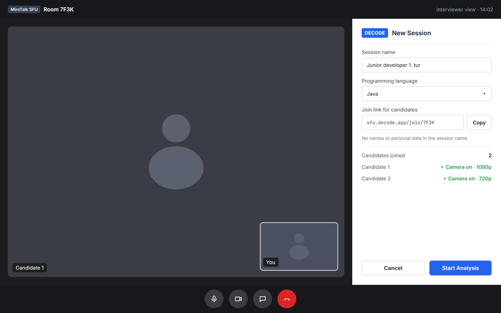
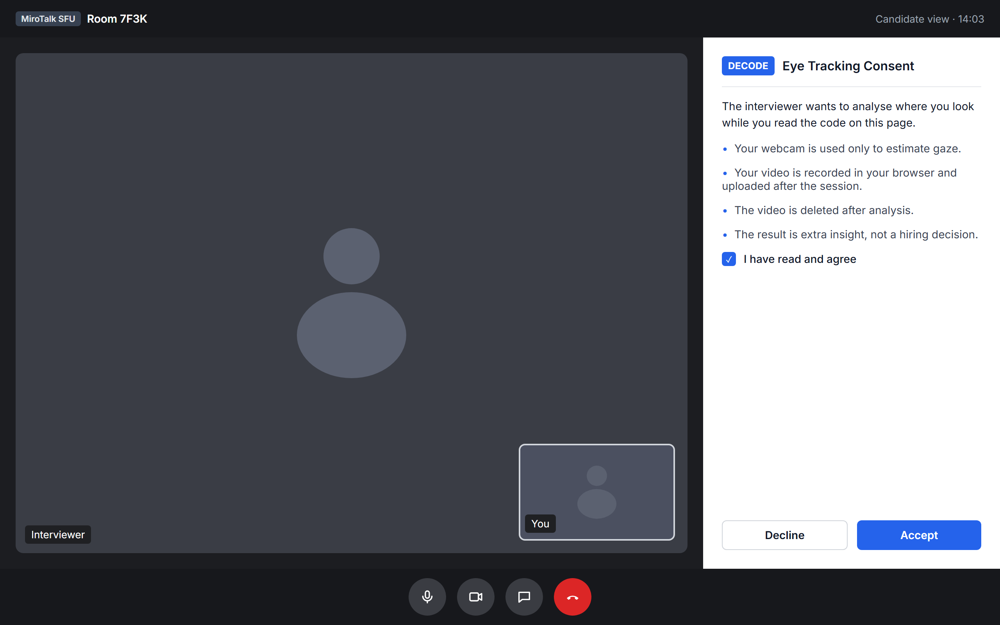
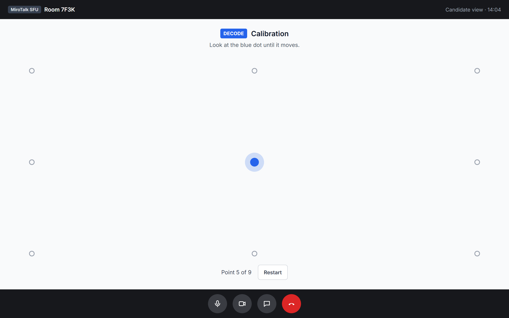
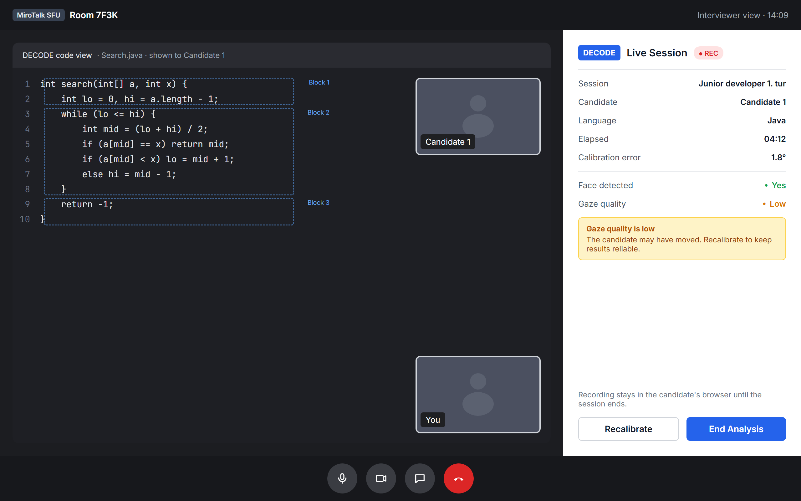
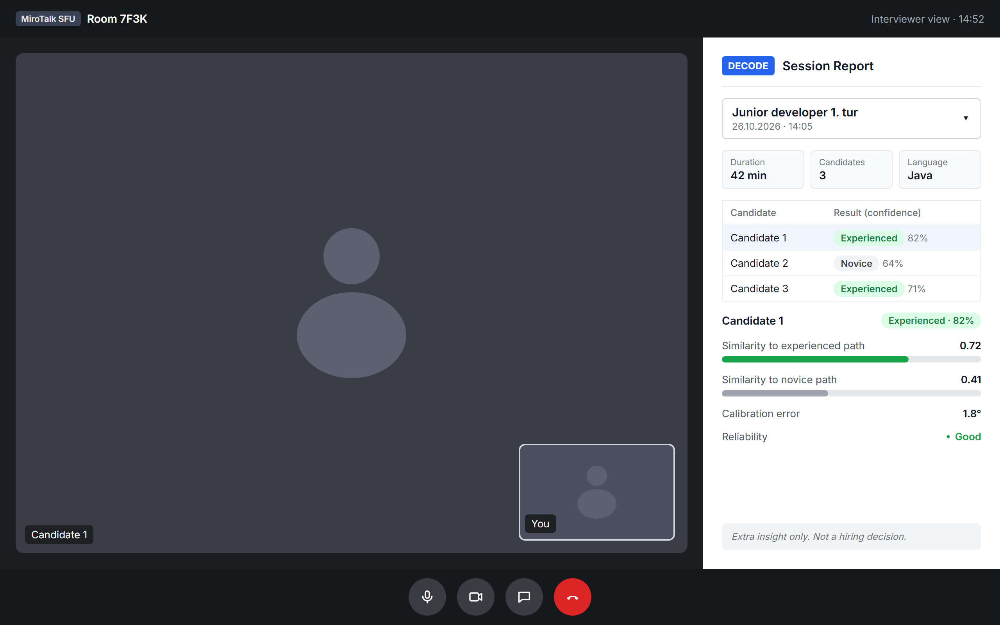

# SRS 1.4.1 + 1.4.1.2 — Taslak (DEC-23)

Durum: taslak. Kaynak: [srs-1.4.2-2.2-taslak.md](srs-1.4.2-2.2-taslak.md) (F1–F9 ve use case'ler).

Diyagram kaynağı: [context-diagram.puml](context-diagram.puml).

Ekranların kaynağı: [ui/html/](ui/html/) (HTML + CSS). PNG'leri üretmek için `python -I ui/html/build.py` çalıştır; Edge ya da Chrome ile `ui/*.png` dosyalarını yeniden çizer. Tasarım, Figma'daki ilk taslağın ([DECODE - SRS UI](https://www.figma.com/design/1RimeDpMtFxSumT6dgpSTQ)) aynısı; Figma MCP sınırı yüzünden güncel hali HTML'de. Figma dosyası eski kaldı.

1.4.1.1 System Interfaces henüz yazılmadı. Context diyagramındaki iki dış sistem oranın da iki arayüzü olur.

### Varsayımlar ve açık sorular

- DECODE, MiroTalk SFU görüşmesinin içinde açılan bir panel olarak çizildi (DEC-44); üst barda oda adı görünüyor.
- Aday görüşmeye ve DECODE'a görüşmecinin gönderdiği linkle girer; UI-2 ve UI-3 onun tarayıcısında açılır. Kod da bizim sayfada gösterilir, ekran paylaşımı yok.
- Sonuç oturum sonunda hesaplanır (Toplantı 2), UI-4'te canlı sonuç yok.
- Örnek değerler (kod görevi, 0.72, 1.8° vb.) yalnızca gösterim için.

- Veri seti henüz seçilmedi (EMIP adaylardan biri). Diyagramda genel adıyla duruyor.

---

## 1.4.1 Product Perspective

- DECODE is a new, self-contained tool that runs inside MiroTalk, an existing videoconferencing platform, during remote technical interviews. It does not replace MiroTalk; it adds an analysis panel to it.
- The candidate joins from a link and reads the code in DECODE's own code view, so no screen sharing is needed. The candidate's webcam is recorded in their browser, uploaded after the session and deleted after analysis. DECODE maps the candidate's gaze to code blocks.
- From a public eye-tracking dataset, DECODE takes labelled scanpaths of novice and experienced programmers. These are used offline to build the two trending paths of each code task that candidates are compared with.

## 1.4.1.2 User Interfaces

DECODE runs as a side panel inside the video call, next to the participants' cameras. The interviewer uses three views (setup, live session, report). The candidate sees only the consent and calibration views. The five views below cover the entry point and the main flow; other dialogs (errors, settings) are not shown.

### UI-1 Session Setup

- **Purpose:** Entry view. Prepares an analysis session before the candidate starts reading code.
- **Primary user:** Interviewer
- **Relevant requirement / use case:** F1, Open Session
- **Content and actions:** The interviewer enters a session name, picks the programming language (e.g. Java) and copies the join link for the candidates. The panel lists the candidates who joined, with camera status and resolution (at least 720p). *Start Analysis* sends the consent request to the selected candidate.

### UI-2 Consent

- **Purpose:** Gets the candidate's consent before any capture starts.
- **Primary user:** Candidate
- **Relevant requirement / use case:** F2, Give Consent
- **Content and actions:** The panel explains that the webcam is recorded while the candidate reads, uploaded after the session and deleted after analysis. *Accept* moves to calibration. *Decline* cancels the analysis and nothing is recorded.

### UI-3 Calibration

- **Purpose:** Fits the gaze model to the candidate's camera and screen.
- **Primary user:** Candidate
- **Relevant requirement / use case:** F3, Calibrate Gaze
- **Content and actions:** Opens full screen over the call. Dots appear one at a time and the candidate looks at each one. If the error is too high, calibration repeats. *Restart* starts it again.

### UI-4 Live Session

- **Purpose:** Lets the interviewer follow the recording while the candidate reads the code.
- **Primary user:** Interviewer
- **Relevant requirement / use case:** F4–F7, Run Analysis Session (Capture Video Streams, Analyze Gaze on Code)
- **Content and actions:** The interviewer sees the same DECODE code view the candidate reads, with the code blocks (AOIs) outlined. The panel shows the session, the candidate, the language, elapsed time, calibration error, face detection and gaze quality, with a warning when quality drops. *Recalibrate* repeats UI-3. *End Analysis* stops the recording, uploads it and starts the analysis.

### UI-5 Classification Report

- **Purpose:** Shows the results of all candidates in a finished session.
- **Primary user:** Interviewer
- **Relevant requirement / use case:** F8, View Classification Report
- **Content and actions:** The interviewer picks a session. The panel shows the session name, date, duration and number of candidates, then lists every candidate who joined with the predicted class and its confidence (e.g. Candidate 1 — Experienced, 82%). Selecting a candidate shows the similarity to each trending path, the calibration error and a reliability note (a warning when the error is above the threshold). The result is marked as extra insight, not a hiring decision.
