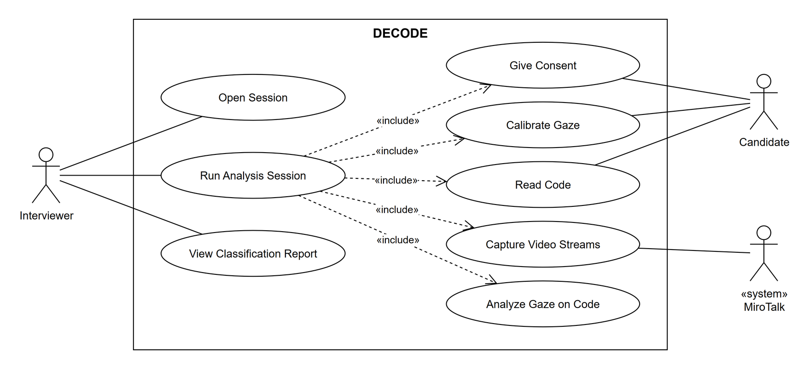

# SRS 1.4.2 + 2.2 — Taslak (DEC-24, DEC-48)

Durum: taslak. Kaynak: [Proposal.md](../../marker_out/Proposal/Proposal.md), [toplantılar](../toplantilar/README.md), [DEC-20 tutarlılık listesi](dec-20-tutarlilik-listesi.md).

Diyagram kaynağı: [use-case-diagram.drawio](use-case-diagram.drawio).

### Uygulanan kararlar

- Platform MiroTalk SFU (DEC-44). Aday bizim client'a linkle girer; kod ve kalibrasyon bizim sayfada gösterilir, ekran paylaşımı ve extension yok.
- Aday videosu kendi tarayıcısında kaydedilir, oturum bitince yüklenir ve analizden sonra silinir.
- AOI'ler kod blokları (DEC-45). Kamera en az 720p, 30 fps.
- Analiz oturum sonrası çalışır, gerçek zamanlı değil (Toplantı 2).
- Researcher aktörü yok. Interviewer için Open Session var. Map Gaze ve Classify, Analyze Gaze on Code içinde birleşik (Toplantı 2). Adayın linkle girişi ayrı use case değil, Open Session ve Run Analysis Session ön koşullarında anlatılıyor.
- Dış sistem MiroTalk SFU (context ve use case diyagramında «system» olarak), Web browser değil.
- Bir oturumda birden çok aday olabilir; rapor aday bazında, trending path'lere benzerlik (sapma) ile (Toplantı 2, ERD).
- Terimler: novice / experienced (DEC-20 #8).

### Açık soru

- Toplantı 2'de kritik use case olarak Generate Trending Paths ve Evaluate Classification Model da sayılmıştı. Model ERD'den çıkarıldığı için (Yeliz Hoca, 26 Ekim) bu ikisi diyagramda yok; trending path'ler F9'da, ürün öncesi hazırlanan bir önkoşul olarak duruyor. Hocayla netleştirilecek.

---

## 1.4.2 Product Functions

| ID | Major Function | Brief Description | Rationale |
|----|----------------|-------------------|-----------|
| F1 | Session Setup | Lets the interviewer open a session for a position, pick the programming language, and share a link that candidates use to join. The system then shows only code with predefined code-block AOIs and trending paths in that language. | STA compares scanpaths on the same stimulus [5], so the candidate must read code the trending paths were built for. |
| F2 | Consent and Privacy | Requires the candidate's consent before recording and deletes the webcam video after analysis. | Eye and face data are personal data (GDPR/KVKK). |
| F3 | Gaze Calibration | Asks the candidate to look at known points on screen before reading to fit the gaze model to their setup. | Webcam gaze estimation is inaccurate without per-user calibration. |
| F4 | Webcam Recording | Records the candidate's webcam (at least 720p, 30 fps) in their browser while they read the code in DECODE's code view, and uploads it when the session ends. | Recording before network encoding keeps gaze error low, and the system must work remotely in an interview (Milestone 6). |
| F5 | Gaze-to-Code Mapping | Estimates where the candidate looks and maps each gaze point to a code block (AOI) of the displayed code. | Webcam gaze error (2–4°) is larger than one code line, so blocks are used. Scanpaths must be AOI sequences to be comparable with trending paths (Milestone 5). |
| F6 | Scanpath Generation | Detects fixations and converts them into the candidate's individual scanpath. | Individual scanpaths are the input to STA-based comparison. |
| F7 | Experience Classification | After the session, compares the candidate's scanpath with both trending paths and labels the candidate as novice or experienced. | Binary classification gives better results than three levels [3]; the same comparison was used for autism detection [6]. |
| F8 | Result Reporting | Shows, for each session, every candidate's predicted class with a confidence value, the similarity to each trending path and the calibration error, with a warning when the error is above the threshold. | The output is meant as additional insight for technical interviews, not a final decision. |
| F9 | Trending Path Model | Holds the novice and experienced trending paths for each code task, built offline with STA from a public eye-tracking dataset. | Core of the approach; STA identifies a representative path per group [5] and has been applied to programmers [4]. |

Function to use case mapping: F1 Open Session, F2 Give Consent, F3 Calibrate Gaze, F4 Capture Video Streams, F5–F7 Analyze Gaze on Code, F8 View Classification Report. Read Code is a candidate action with no function of its own; F4 and F5 depend on it. F9 has no use case: the trending paths are prepared by the project team before deployment and are a precondition of Run Analysis Session.

---

## 2.2 Use Cases

### Use Case Diagram

### Critical Use Cases

#### Open Session

| | |
|---|---|
| **Actors** | Interviewer (primary) |
| **Preconditions** | The interviewer is signed in to DECODE. Trending paths exist for code in at least one programming language. |
| **Main flow** | 1. Interviewer starts a new session. 2. The system lists the programming languages that have code with trending paths. 3. Interviewer selects a language and enters a session name. 4. The system creates the session and a join link. 5. Interviewer sends the link to the candidates. |
| **Alternative flows** | 2a. No language has code with trending paths: the system shows a notice and the session cannot be opened. |
| **Postconditions** | An open session with its language and join link exists. Candidates can join it from the link. |

#### Run Analysis Session

| | |
|---|---|
| **Actors** | Interviewer (primary), Candidate, MiroTalk |
| **Preconditions** | The session is open and the candidate has joined it from the link in their browser, with a camera of at least 720p, 30 fps. |
| **Main flow** | 1. Interviewer starts the analysis for the candidate. 2. The system asks the candidate for consent (Give Consent). 3. The candidate calibrates gaze (Calibrate Gaze): 3.1 the system shows calibration points one by one; 3.2 the candidate looks at each point; 3.3 the system fits the gaze model; 3.4 the system measures the error on a validation point and accepts it if within the threshold. 4. The system shows code in the selected language in the candidate's code view and the candidate reads it (Read Code). 5. The candidate's webcam is recorded in their browser (Capture Video Streams). 6. Interviewer ends the analysis and the recording is uploaded. 7. The system analyzes gaze on code (Analyze Gaze on Code): 7.1 maps gaze points to code-block AOIs; 7.2 builds the candidate's scanpath; 7.3 compares it with both trending paths and picks the more similar class. 8. The system deletes the video. |
| **Alternative flows** | 2a. Candidate declines consent: the analysis is cancelled, nothing is recorded. 3.4a. Calibration error above threshold: the system repeats calibration (at most N times), then warns that results may be unreliable. 5a. Face not detected: the system warns the interviewer and offers recalibration. |
| **Postconditions** | The candidate's scanpath, calibration error and classification result with similarity scores are stored. The video is deleted. |

#### View Classification Report

| | |
|---|---|
| **Actors** | Interviewer (primary) |
| **Preconditions** | Run Analysis Session has finished for at least one candidate. |
| **Main flow** | 1. Interviewer opens the report view. 2. The system lists sessions by name and start time. 3. Interviewer selects a session. 4. The system shows the session name, date and duration, and lists its candidates with their predicted class and confidence. 5. Interviewer selects a candidate. 6. The system shows the similarity to each trending path and the calibration error. |
| **Alternative flows** | 6a. Calibration error above the threshold: the system marks the result as unreliable and shows the reason. |
| **Postconditions** | No data is changed. |

### Other Use Cases

| Use Case | Actor | One Sentence Description |
|----------|-------|--------------------------|
| Give Consent | Candidate | The candidate accepts or declines webcam recording before it starts (flow in Run Analysis Session, step 2). |
| Calibrate Gaze | Candidate | The candidate looks at on-screen points so the gaze model fits their setup (flow in Run Analysis Session, step 3). |
| Read Code | Candidate | The candidate reads the code shown in DECODE's code view while the webcam is recorded (flow in Run Analysis Session, step 4). |
| Capture Video Streams | MiroTalk | Our MiroTalk fork records the candidate's webcam in their browser and uploads it when the session ends (flow in Run Analysis Session, steps 5–6). |
| Analyze Gaze on Code | — (included in Run Analysis Session) | The system maps gaze to code blocks, builds the scanpath and classifies the candidate (flow in Run Analysis Session, step 7). |

### References

Numbers follow the Proposal reference list: [3] Ahsan & Obaidellah 2025, [4] Ahsan & Obaidellah 2023, [5] Eraslan et al. 2016, [6] Eraslan et al. 2020.
