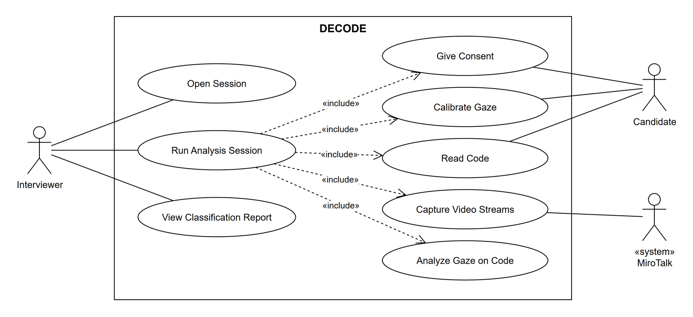

# SRS 1.4.2 + 2.2 — Taslak (DEC-24, DEC-48)

Durum: taslak. Kaynak: [Proposal.md](../../marker_out/Proposal/Proposal.md), [toplantılar](../toplantilar/README.md), [DEC-20 tutarlılık listesi](dec-20-tutarlilik-listesi.md).

Diyagram kaynağı: [use-case-diagram.drawio](use-case-diagram.drawio).

### Uygulanan kararlar

- Platform MiroTalk SFU (DEC-44). Aday bizim client'a linkle girer; kod ve kalibrasyon bizim sayfada gösterilir, ekran paylaşımı ve extension yok.
- Aday videosu kendi tarayıcısında kaydedilir, oturum bitince yüklenir ve analizden sonra silinir.
- AOI'ler kod blokları (DEC-45). Kamera en az 720p, 30 fps.
- Analiz oturum sonrası çalışır, gerçek zamanlı değil (Toplantı 2).
- Researcher aktörü yok. Interviewer için Open Session var. Map Gaze ve Classify, Analyze Gaze on Code içinde birleşik (Toplantı 2). Adayın linkle girişi ayrı use case değil, Open Session ve Run Analysis Session ön koşullarında anlatılıyor.
- Dış sistem MiroTalk SFU (context ve use case diyagramında «system» olarak), Web browser değil.
- Bir oturumda birden çok aday olabilir; rapor aday bazında, trending path'lere benzerlik (sapma) ile (Toplantı 2, ERD).
- Terimler: novice / experienced (DEC-20 #8).
- Kritik use case açıklamaları CNG350 şablonunda (Use case, Actors, Cross references, Typical Course of Events: Actor Intentions / System Responsibility, Alternative Courses). Şablonda pre/postcondition yok; 720p kamera koşulu 3. bölümdeki gereksinimlere gidecek. Biçim ders örneğine (CNG350 Lecture 4 in-class exercise) göre: her satırda tek adım, alternatiflerde "Step N", Cross references'ta F numarası değil ilişkili use case'ler (yoksa N/A).
- Open Session kritik değil, özet tabloda (Toplantı 2'nin kritik listesinde yok; basit form). Kritik: Run Analysis Session, View Classification Report (27 Ekim, İrem).

### F9 kararı (27 Ekim, İrem)

- Toplantı 2'de kritik use case olarak Generate Trending Paths ve Evaluate Classification Model da sayılmıştı. ClassificationModel ERD'den çıkarıldığı için (Yeliz Hoca, 26 Ekim) bu ikisi diyagramda yok.
- F9 tabloda kalıyor: trending path'ler ERD'de hâlâ var (Dataset CONTAINS Scanpath, experienceLevel), 2.5 varsayımları F9'a atıf yapıyor ve F7 onlara dayanıyor. F9 "Trending Path Storage" oldu; sistemin path'leri tutup sınıflandırmaya vermesini anlatıyor, offline üretim yalnızca bağlam.

---

## 1.4.2 Product Functions

| ID | Major Function | Brief Description | Rationale/Source |
|----|----------------|-------------------|-----------|
| F1 | Session Setup | Lets the interviewer open a session, pick the programming language and share a join link with the candidates. | STA compares scanpaths on the same stimulus, so the candidate must read code the trending paths were built for. |
| F2 | Consent and Privacy | Requires the candidate's consent before recording and deletes the webcam video after analysis. | Eye and face data are personal data (GDPR/KVKK). |
| F3 | Gaze Calibration | Asks the candidate to look at known points on screen before reading to fit the gaze model to their setup. | Webcam gaze estimation is inaccurate without per-user calibration. |
| F4 | Webcam Recording | Records the candidate's webcam in their browser while they read the code and uploads it when the session ends. | Recording before network encoding keeps gaze error low, and the system must work remotely in an interview (Milestone 6). |
| F5 | Gaze-to-Code Mapping | Estimates where the candidate looks and maps each gaze point to a code block (AOI) of the displayed code. | Webcam gaze error (2–4°) is larger than one code line, so blocks are used. Scanpaths must be AOI sequences to be comparable with trending paths (Milestone 5). |
| F6 | Scanpath Generation | Detects fixations and converts them into the candidate's individual scanpath. | Individual scanpaths are the input to STA-based comparison. |
| F7 | Experience Classification | After the session, compares the candidate's scanpath with both trending paths and labels the candidate as novice or experienced. | Binary classification gives better results than three levels; the same comparison was used for autism detection. |
| F8 | Result Reporting | Shows each candidate's predicted class with its confidence and how reliable the result is. | The output is meant as additional insight for technical interviews, not a final decision. |
| F9 | Trending Path Storage | Stores the novice and experienced trending paths of each code stimulus and provides them for classification. The paths are built offline with STA from a public eye-tracking dataset. | Core of the approach; STA identifies a representative path per group and has been applied to programmers. |

Function to use case mapping: F1 Open Session, F2 Give Consent, F3 Calibrate Gaze, F4 Capture Video Streams, F5–F7 Analyze Gaze on Code, F8 View Classification Report. Read Code is a candidate action with no function of its own; F4 and F5 depend on it. F9 has no use case: the trending paths are prepared by the project team before deployment and are a precondition of Run Analysis Session.

---

## 2.2 Use Cases

### Use Case Diagram

### Critical Use Cases

DECODE has eight use cases. Detailed descriptions are provided only for the two critical ones; the rest are summarised in the table below. The included use cases are part of Run Analysis Session only, so they are described within its flow.

#### Run Analysis Session

| | |
|---|---|
| **Use case** | Run Analysis Session |
| **Actors** | Interviewer, Candidate, MiroTalk |
| **Cross references** | Give Consent, Calibrate Gaze, Read Code, Capture Video Streams, Analyze Gaze on Code |
| **Typical Course of Events** | |
| **Actor Intentions** | **System Responsibility** |
| 1. The interviewer starts the analysis for a candidate who joined the session from the link. | |
| | 2. The system asks the candidate for consent (Give Consent). |
| 3. The candidate accepts. | |
| | 4. The system shows calibration points one by one (Calibrate Gaze). |
| 5. The candidate looks at each point. | |
| | 6. The system fits the gaze model, measures the error on a validation point and accepts it if within the threshold. |
| | 7. The system shows the code in the candidate's code view and records the candidate's webcam in their browser (Capture Video Streams). |
| 8. The candidate reads the code (Read Code). | |
| 9. The interviewer ends the analysis. | |
| | 10. The system uploads the recording and analyses gaze on code (Analyze Gaze on Code): it maps gaze points to code-block AOIs, builds the scanpath and compares it with both trending paths to pick the more similar class. |
| | 11. The system stores the result and deletes the video. |
| **Alternative Courses** | |
| Step 3: The candidate declines consent, so the analysis is cancelled and nothing is recorded. | |
| Step 6: The calibration error is above the threshold, so the system repeats calibration from Step 4 (at most N times), then warns that the results may be unreliable. | |
| Step 7: The candidate's face is not detected, so the system warns the interviewer and offers recalibration (return to Step 4). | |

#### View Classification Report

| | |
|---|---|
| **Use case** | View Classification Report |
| **Actors** | Interviewer |
| **Cross references** | N/A |
| **Typical Course of Events** | |
| **Actor Intentions** | **System Responsibility** |
| 1. The interviewer opens the report view. | |
| | 2. The system lists the sessions by name and start time. |
| 3. The interviewer selects a session. | |
| | 4. The system shows the session name, date and duration, and lists its candidates with their predicted class and confidence. |
| 5. The interviewer selects a candidate. | |
| | 6. The system shows the similarity to each trending path and the calibration error. |
| **Alternative Courses** | |
| Step 2: No session has a finished analysis, so the operation is cancelled. | |
| Step 6: The calibration error is above the threshold, so the system marks the result as unreliable and shows the reason. | |

### Other Use Cases

| Use Case | Actor | One Sentence Description |
|----------|-------|--------------------------|
| Open Session | Interviewer | The interviewer opens a session, picks the programming language and shares a join link with the candidates. |
| Give Consent | Candidate | The candidate accepts or declines webcam recording before it starts (Run Analysis Session, steps 2–3). |
| Calibrate Gaze | Candidate | The candidate looks at on-screen points so the gaze model fits their setup (Run Analysis Session, steps 4–6). |
| Read Code | Candidate | The candidate reads the code shown in DECODE's code view while the webcam is recorded (Run Analysis Session, steps 7–8). |
| Capture Video Streams | MiroTalk | Our MiroTalk fork records the candidate's webcam in their browser and uploads it when the session ends (Run Analysis Session, steps 7 and 10). |
| Analyze Gaze on Code | — (included in Run Analysis Session) | The system maps gaze to code blocks, builds the scanpath and classifies the candidate (Run Analysis Session, step 10). |

### References

Numbers follow the Proposal reference list: [3] Ahsan & Obaidellah 2025, [4] Ahsan & Obaidellah 2023, [5] Eraslan et al. 2016, [6] Eraslan et al. 2020.
