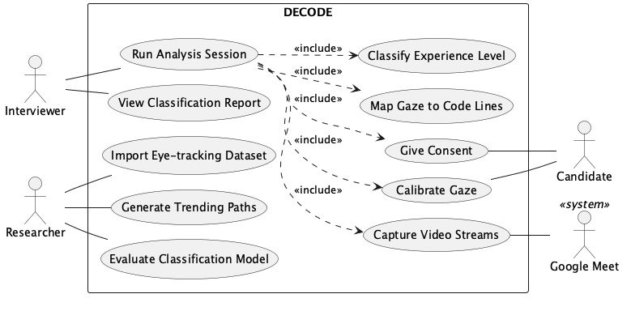

# SRS 1.4.2 + 2.2 — Taslak (DEC-24)

Durum: taslak, 21 Ekim 2026 toplantısında hocalarla gözden geçirilecek. Kaynak: [Proposal.md](../../marker_out/Proposal/Proposal.md), [toplanti-notlari.md](../toplanti-notlari.md).

Diyagram kaynağı: [use-case-diagram.puml](use-case-diagram.puml)

### Açık sorular (toplantıda netleşecek)

- ~~Hedef platform~~ Karar (20 Ekim): Google Meet.
- Gerçek zamanlı sınıflandırma mı, oturum sonrası analiz mi? (UC-01 ve F6)
- AOI satır seviyesinde mi, blok seviyesinde mi? Webcam doğruluğuna bağlı (DEC-22).
- Aday eklentiyle doğrudan etkileşiyor mu (rıza, kalibrasyon), yoksa her şeyi görüşmeci mi yönetiyor?
- Offline model kısmı (UC-08–UC-10) ürünün parçası mı, yoksa yalnızca araştırma çıktısı mı?

---

## 1.4.2 Product Functions

| ID | Major Function | Brief Description | Rationale |
|----|----------------|-------------------|-----------|
| F1 | STA Model Generation | Builds trending paths for novice and experienced programmers from a public eye-tracking dataset using Scanpath Trend Analysis. | Core of the approach; STA identifies a representative path per group [5] and has been applied to programmers [4]. |
| F2 | Video Stream Capture | Captures the candidate's webcam stream and the shared code screen from the videoconferencing tool during a session. | The system must work remotely, inside an existing interview setting (Milestone 6). |
| F3 | Gaze Calibration | Asks the candidate to look at known points on screen before analysis to fit the gaze model to their setup. | Webcam gaze estimation is inaccurate without per-user calibration. |
| F4 | Gaze-to-Code Mapping | Estimates where the candidate looks and maps each gaze point to a line (AOI) of the displayed source code. | Scanpaths must be expressed as sequences of code AOIs to be comparable with trending paths (Milestone 5). |
| F5 | Scanpath Generation | Detects fixations and converts them into the candidate's individual scanpath. | Individual scanpaths are the input to STA-based comparison. |
| F6 | Experience Classification | Compares the candidate's scanpath with both trending paths and labels the candidate as novice or experienced. | Binary classification gives better results than three levels [3]; the same comparison was used for autism detection [6]. |
| F7 | Result Reporting | Shows the predicted class, the similarity to each trending path, and data quality warnings to the interviewer. | The output is meant as additional insight for technical interviews, not a final decision. |
| F8 | Consent and Privacy | Requires the candidate's consent before capture and avoids storing raw video. | Eye and face data are personal data (GDPR/KVKK). |
| F9 | Dataset Import | Loads a public eye-tracking dataset with experience labels, fixations and code AOIs. | Trending paths need labelled data from real programmers; collecting our own is out of scope. |
| F10 | Model Evaluation | Measures classification accuracy, precision and recall on held-out participants. | Shows whether the STA-based classifier actually separates novice and experienced programmers. |

---

## 2.2 Use Cases

### Use Case Diagram

### Critical Use Cases

#### UC-01 Run Analysis Session

| | |
|---|---|
| **Actors** | Interviewer (primary), Candidate, Google Meet |
| **Preconditions** | The extension is installed. Trending paths exist (UC-09). Interviewer and candidate are in the same meeting. |
| **Main flow** | 1. Interviewer starts an analysis session from the extension. 2. The system asks the candidate for consent (UC-02). 3. The candidate calibrates gaze (UC-03): 3.1 the system shows calibration points one by one; 3.2 the candidate looks at each point; 3.3 the system fits the gaze model; 3.4 the system measures the error on a validation point and accepts it if within the threshold. 4. The candidate shares the code on screen and reads it. 5. The system captures webcam and screen streams (UC-04) and maps gaze to code lines (UC-05). 6. Interviewer ends the session. 7. The system generates the scanpath and classifies the candidate (UC-06). 8. Interviewer views the report (UC-07). |
| **Alternative flows** | 2a. Candidate declines consent: session is cancelled, nothing is recorded. 3.4a. Calibration error above threshold: the system repeats calibration (at most N times), then warns that results may be unreliable. 5a. Face not detected or gaze quality too low: the system warns the interviewer and offers recalibration. |
| **Postconditions** | A classification result with similarity scores is available to the interviewer. The calibration error is kept with the result. Raw video is not stored. |

#### UC-09 Generate Trending Paths

| | |
|---|---|
| **Actors** | Researcher (primary) |
| **Preconditions** | A labelled eye-tracking dataset (novice / experienced) is imported (UC-08). AOIs are defined for each code stimulus. |
| **Main flow** | 1. Researcher selects the dataset and code stimuli. 2. The system builds individual scanpaths per participant. 3. The system splits scanpaths by experience label. 4. The system runs STA on each group and produces one trending path per group. 5. Researcher saves the trending paths as the classification model. |
| **Alternative flows** | 3a. A group has too few participants: the system reports it and stops. |
| **Postconditions** | Novice and experienced trending paths are stored and used by UC-06. |

#### UC-10 Evaluate Classification Model

| | |
|---|---|
| **Actors** | Researcher (primary) |
| **Preconditions** | A labelled dataset is imported (UC-08). |
| **Main flow** | 1. Researcher selects the dataset and the share of participants to hold out. 2. The system splits participants into training and test sets. 3. The system generates trending paths from the training set (as in UC-09). 4. The system classifies each test participant by comparing their scanpath with both trending paths. 5. The system compares predictions with the true labels and reports accuracy, precision and recall. 6. Researcher saves the evaluation report. |
| **Alternative flows** | 2a. Too few participants for a split: the system switches to leave-one-out evaluation. |
| **Postconditions** | An evaluation report is stored with the model version it belongs to. |

### Other Use Cases

| Use Case | Actor | One Sentence Description |
|----------|-------|--------------------------|
| UC-02 Give Consent | Candidate | The candidate accepts or declines eye tracking before any capture starts. |
| UC-03 Calibrate Gaze | Candidate | The candidate looks at on-screen points so the gaze model fits their setup (flow in UC-01, step 3). |
| UC-04 Capture Video Streams | Google Meet | The system receives the webcam and shared screen streams from the meeting. |
| UC-05 Map Gaze to Code Lines | System (included in UC-01) | The system turns gaze points into fixations on code-line AOIs. |
| UC-06 Classify Experience Level | System (included in UC-01) | The system compares the scanpath with both trending paths and picks the more similar one. |
| UC-07 View Classification Report | Interviewer | The interviewer sees the predicted class, similarity scores and quality warnings. |
| UC-08 Import Eye-tracking Dataset | Researcher | The researcher loads a public dataset with experience labels and fixation data. |

### References

Numbers follow the Proposal reference list: [3] Ahsan & Obaidellah 2025, [4] Ahsan & Obaidellah 2023, [5] Eraslan et al. 2016, [6] Eraslan et al. 2020.
