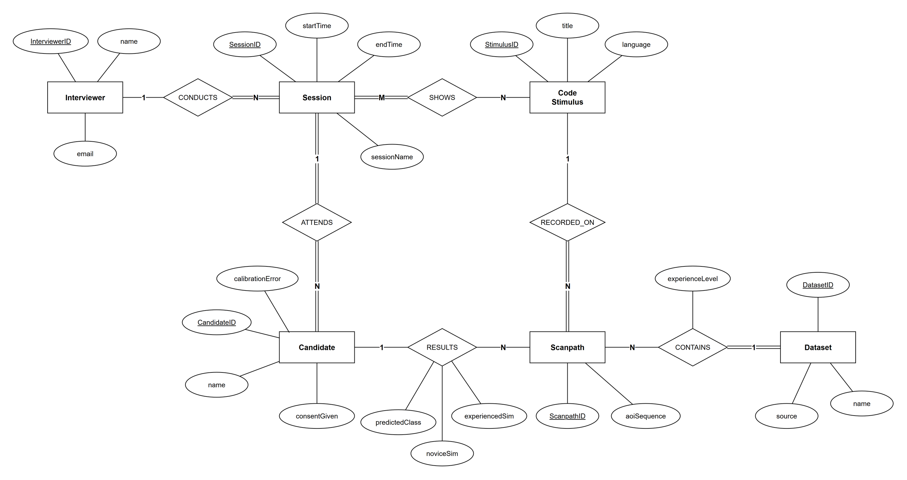

# SRS 2.5 — Sade Taslak (DEC-26)

Durum: taslak. **SRS'te kullanılacak ana sürüm bu.** Tam sürüm yedek olarak [alternatif/srs-2.5-taslak.md](alternatif/srs-2.5-taslak.md) içinde.

Diyagram kaynağı: [erd.drawio](erd.drawio) (Chen notasyonu). Terimler novice / experienced (DEC-20 #8); `expertSim` → `experiencedSim` oldu.

### Önceki sade sürümden farkı

- ClassificationModel, ClassificationResult ve TrendingPath yok. Sonuç, Candidate ile Scanpath arasındaki RESULTS ilişkisinin özellikleri olarak tutulur.
- AOI ve Fixation yok. Scanpath, AOI sırasını `aoiSequence` olarak tek alanda tutar.
- Participant yok. Dataset, referans scanpath'lere tek bir CONTAINS ilişkisiyle bağlanır; novice/experienced ayrımı ilişkinin `experienceLevel` özelliğinde tutulur.
- Candidate geri geldi. `consentGiven` ve `calibrationError` Session'dan Candidate'e taşındı; kalibrasyonu aday yapar.
- Session'daki `label` adı `sessionName` oldu; interviewer oturumu listede bununla ayırt eder.
- Session birden çok CodeStimulus gösterebilir (M:N).
- Sadeleştirme (27 Ekim, İrem): ilişki özellikleri tablosu kaldırıldı, özellikler entity tablosunun Relationships sütununda. ERD'de görünen kısıtlar (PK unique/not null, FK var olan satıra işaret eder) çıkarıldı; ERD'nin gösteremediği domain, cascade ve business rule'lar kaldı. Assumptions 10 maddeden 5'e indi ("A Candidate attends one Session and calibrates once" çıktı; DEC-45 atfı çıktı). İkinci tur: kısıtlar alt başlıksız 5 maddeye, assumptions 2 maddeye indi (yalnızca en önemliler). Çıkanlar: sessionName ≤ 50, calibrationError ≥ 0, endTime > startTime, aoiSequence boş olamaz, "RECORDED_ON a CodeStimulus that their Session SHOWS"; ayrı "exactly two Scanpaths" kuralı 4. maddeye girdi; video, trending path ve hesaplanan alanlar varsayımları çıktı.

---

## 2.5 Logical Database Requirements

The system uses a relational database to store interviewers, sessions, candidates, code stimuli, scanpaths and the reference dataset. The candidate's webcam video is never stored in the database; it is deleted after analysis (F2).

### Entity Relationship Diagram

### Entity Summary

| Entity | Purpose | Attributes | Relationships |
|--------|---------|------------|---------------|
| Interviewer | User who runs interview sessions. | <u>InterviewerID</u>, name, email | CONDUCTS Session (1:N). |
| Session | One interview meeting. | <u>SessionID</u>, sessionName, startTime, endTime | Conducted by Interviewer (N:1), SHOWS CodeStimulus (M:N), ATTENDS Candidate (1:N). |
| Candidate | Person whose code reading is analysed. | <u>CandidateID</u>, name, consentGiven, calibrationError | Attends Session (N:1), RESULTS Scanpath (1:N) with predictedClass, noviceSim, experiencedSim. |
| CodeStimulus | Source code shown to the reader (e.g. A.java). | <u>StimulusID</u>, title, language | Shown in Session (M:N), has Scanpaths RECORDED_ON it (1:N). |
| Scanpath | Ordered AOI sequence of one reader on one stimulus. | <u>ScanpathID</u>, aoiSequence | RECORDED_ON CodeStimulus (N:1), linked to Candidate through RESULTS (N:1), contained in Dataset (N:1). |
| Dataset | Public labelled eye-tracking reference data. | <u>DatasetID</u>, name, source | CONTAINS Scanpath (1:N) with experienceLevel. |

### Integrity Constraints

Primary keys and cardinalities are shown in the ERD. The constraints below cannot be shown in it.

- predictedClass and experienceLevel are either novice or experienced; similarity scores are between 0 and 1.
- If consentGiven is false, the Candidate has no Scanpath or result.
- A Scanpath belongs either to a Candidate or to a Dataset, never both.
- A Candidate's Scanpath is compared only with the two Dataset Scanpaths (one novice, one experienced) recorded on the same CodeStimulus.
- Deleting a Candidate deletes their Scanpaths and results.

### Assumptions

- The code shown in an interview is one of the dataset's code stimuli, so the comparison is made on the same code.
- AOIs are code blocks fixed per stimulus outside the database, so they are not an entity.
