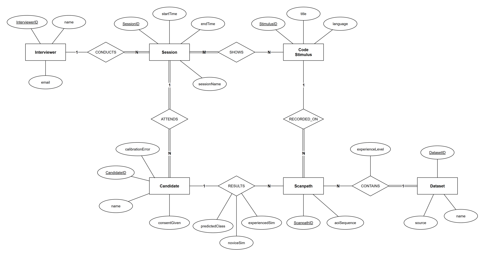

# SRS 2.5 — Sade Taslak (DEC-26)

Durum: taslak. **SRS'te kullanılacak ana sürüm bu.** Tam sürüm yedek olarak [alternatif/srs-2.5-taslak.md](alternatif/srs-2.5-taslak.md) içinde.

Diyagram kaynağı: [erd.drawio](erd.drawio) (Chen notasyonu). Terimler novice / experienced (DEC-20 #8); `expertSim` → `experiencedSim` oldu.

### Önceki sade sürümden farkı

- ClassificationModel, ClassificationResult ve TrendingPath yok. Sonuç, Candidate ile Scanpath arasındaki RESULTS ilişkisinin özellikleri olarak tutulur.
- AOI ve Fixation yok. Scanpath, AOI sırasını `aoiSequence` olarak tek alanda tutar.
- Participant yok. Dataset, referans scanpath'lere tek bir CONTAINS ilişkisiyle bağlanır; novice/experienced ayrımı ilişkinin `experienceLevel` özelliğinde tutulur.
- Candidate geri geldi. `consentGiven` ve `calibrationError` Session'dan Candidate'e taşındı; kalibrasyonu aday yapar.
- Session'daki `label` adı `sessionName` oldu; interviewer oturumu listede bununla ayırt eder.
- Session birden çok CodeStimulus gösterebilir (M:N).

---

## 2.5 Logical Database Requirements

The system uses a relational database to store interviewers, sessions, candidates, code stimuli, scanpaths and the reference dataset. The candidate's webcam video is never stored in the database; it is deleted after analysis (F2).

### Entity Relationship Diagram

### Entity Summary

| Entity | Purpose | Attributes | Relationships |
|--------|---------|------------|---------------|
| Interviewer | User who runs interview sessions. | <u>InterviewerID</u>, name, email | CONDUCTS Session (1:N). |
| Session | One interview meeting. | <u>SessionID</u>, sessionName, startTime, endTime | Conducted by Interviewer (N:1), SHOWS CodeStimulus (M:N), ATTENDS Candidate (1:N). |
| Candidate | Person whose code reading is analysed. | <u>CandidateID</u>, name, consentGiven, calibrationError | Attends Session (N:1), RESULTS Scanpath (1:N). |
| CodeStimulus | Source code shown to the reader (e.g. A.java). | <u>StimulusID</u>, title, language | Shown in Session (M:N), has Scanpaths RECORDED_ON it (1:N). |
| Scanpath | Ordered AOI sequence of one reader on one stimulus. | <u>ScanpathID</u>, aoiSequence | RECORDED_ON CodeStimulus (N:1), linked to Candidate through RESULTS (N:1), contained in Dataset (N:1). |
| Dataset | Public labelled eye-tracking reference data. | <u>DatasetID</u>, name, source | CONTAINS Scanpath (1:N). |

**Relationship attributes**

| Relationship | Attributes | Meaning |
|--------------|------------|---------|
| RESULTS | predictedClass, noviceSim, experiencedSim | Classification of the candidate's scanpath against the novice and experienced trending paths. |
| CONTAINS | experienceLevel | Whether a trending path belongs to the novice or the experienced group. |

### Integrity Constraints

**Entity integrity**
- Every primary key is unique and not null.

**Referential integrity**
- Every foreign key refers to an existing row.
- Deleting a Candidate deletes their Scanpaths and results (cascade).

**Domain constraints**
- predictedClass, experienceLevel ∈ {novice, experienced}.
- noviceSim, experiencedSim ∈ [0, 1].
- calibrationError ≥ 0 and endTime > startTime.
- aoiSequence is a non-empty ordered list of code-block AOI labels.
- sessionName is short free text (at most 50 characters) entered by the interviewer.

**Business rules**
- If consentGiven is false, the Candidate has no Scanpath or result.
- A Scanpath belongs either to a Candidate (RESULTS) or to a Dataset (CONTAINS), never both.
- A Candidate's Scanpath is RECORDED_ON a CodeStimulus that their Session SHOWS.
- A Candidate's Scanpath is compared only with the novice and experienced Scanpaths RECORDED_ON the same CodeStimulus.
- Each Dataset CONTAINS exactly two Scanpaths: one with experienceLevel = novice and one with experienceLevel = experienced. This cannot be shown in Chen notation, so it is stated here.

### Assumptions

- The code shown in an interview is one of the dataset's code stimuli. Comparison is only meaningful on the same code.
- A Candidate attends one Session and calibrates once in it, so calibrationError is stored on the Candidate.
- The Scanpaths a Dataset CONTAINS are the trending paths of one CodeStimulus, built offline with STA (F9).
- Each Dataset row holds the novice and experienced trending path for one CodeStimulus.
- Dataset scanpaths use the same AOI labels as interview scanpaths, so they are comparable.
- AOIs are code blocks (DEC-45). They are fixed per stimulus outside the database and are not modelled as an entity.
- Video is deleted after analysis, so there is no video entity.
- Data quality warnings are not stored; the report derives them from calibrationError.
- The confidence shown in the report is computed from noviceSim and experiencedSim and is not stored.
- Session duration is computed from startTime and endTime.
